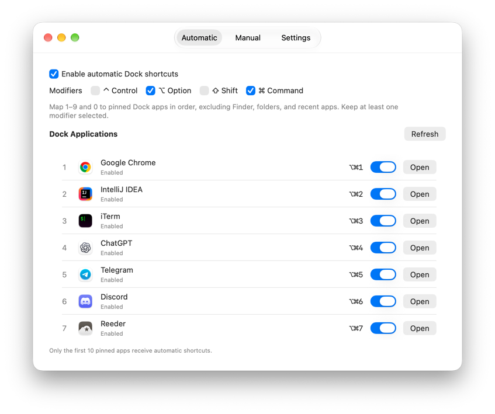
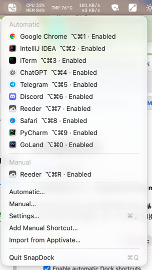

# SnapDock

[English](README.md) | 简体中文

**让快捷键跟随 Dock，用键盘启动和切换 macOS 应用。**

面向 Apple Silicon Mac 的菜单栏工具，用来替代 [Snap](https://apps.apple.com/us/app/snap/id418073146?mt=12)。Dock 里的固定应用对应 `Option+1`…`Option+0`，其他应用可以自定义快捷键。按一下启动或切换到该应用，再按一下隐藏它。

<p align="center">
  
  
</p>

## 功能

- **Dock 快捷键：** 按 Dock 顺序对应前十个固定应用，跳过 Finder、文件夹和最近使用的应用。
- **自定义快捷键：** 为任意应用录制按键组合，按键相同时优先于 Dock 快捷键。
- **单独开关：** 可以关闭某个快捷键，配置会保留。
- **导入：** 从 Snap 或 Apptivate 导入，导入前先预览。
- **中英文界面：** 在「设置 → 应用语言」中切换。

## 构建

需要 Apple Silicon Mac、macOS 13 或更新版本，以及带 Swift 6.1+ 和 macOS 26 SDK 的 Command Line Tools。

```bash
./Scripts/build-app.sh          # 构建 release → dist/SnapDock.app
./Scripts/package-release.sh    # 另外打包磁盘映像 → dist/SnapDock-<版本号>.dmg
```

把 `dist/SnapDock.app` 复制到「应用程序」即完成安装。为保持当前外观，构建固定使用 macOS 26 SDK；如需换用其他 SDK，可设置 `SNAPDOCK_SDK`。应用为 ad-hoc 签名，未经公证。

## 使用说明

### 1. 安装与首次启动

从 [Releases](https://github.com/Mike-Acb/snapdock/releases) 下载 `SnapDock-<版本号>.dmg`，或[自行构建](#构建)，然后把 SnapDock 拖进「应用程序」。应用未经公证，首次打开会被 macOS 拦下：到「系统设置 → 隐私与安全性」点「仍要打开」，或运行：

```bash
xattr -dr com.apple.quarantine /Applications/SnapDock.app
```

首次启动会打开设置窗口。SnapDock 常驻菜单栏，不显示 Dock 图标。关闭设置窗口后它仍在运行，从菜单栏图标选「设置…」或重新打开应用即可回到设置。

### 2. Dock 快捷键：「自动」标签页

1. 把常用应用固定到 Dock，并拖成想要的顺序。
2. 按 `Option+1` 打开第一个固定应用，`Option+2` 打开第二个，依此类推，`Option+0` 对应第十个。Finder、文件夹和最近使用的应用会跳过，不占编号。
3. 想换修饰键，就勾选 Control、Option、Shift、Command 中的任意几个，至少保留一个。

列表会自动跟随 Dock 变化；看起来没更新时点「刷新」。每一行显示快捷键和状态，用开关可以单独关闭，点「打开」可以试一下。

### 3. 自定义快捷键：「手动」标签页

1. 点「添加…」，再点「选择应用…」，选中一个应用。
2. 点「快捷键」输入框，按下包含 ⌘、⌥、⌃ 或 ⇧ 的按键组合。
3. 点「保存」。

按键相同时，手动快捷键优先于 Dock 快捷键。同一个应用可以设置多个手动快捷键。用「编辑…」和「移除」修改；只想暂时停用就关掉开关，配置会保留。

### 4. 按下快捷键会发生什么

- **应用没在运行：** 启动它。
- **应用在后台：** 切换过去；没有窗口时会打开一个。
- **应用已在前台：** 隐藏它（需开启「再次按下快捷键时隐藏前台应用」，默认开启）。

菜单栏图标会列出所有快捷键及其状态，点某一项即可切换到对应应用；菜单里还有「添加手动快捷键…」「从 Apptivate 导入…」和「退出 SnapDock」。

### 5. 「设置」标签页

- **应用语言：** 跟随系统、简体中文或 English。
- **再次按下快捷键时隐藏前台应用：** 见上文。
- **在菜单栏显示 SnapDock：** 关闭后，重新打开应用即可进入设置。
- **登录时启动 SnapDock：** macOS 可能要求到「系统设置 → 通用 → 登录项」中批准。

### 从 Snap 或 Apptivate 导入

- **Snap：** 「设置 → 从 Snap 导入…」只读取 Snap 的偏好设置，不会修改 Snap 或 Dock。预览会列出快捷键和将要变更的设置（当前 → 导入后）。现有手动快捷键会保留，冲突项会跳过，登录启动设置不变。导入前会先备份，可用「恢复导入前配置…」撤销。在 SnapDock 里使用和 Snap 相同的快捷键之前，请先退出 Snap。
- **Apptivate：** 「手动 → 从 Apptivate 导入…」可以勾选要导入的快捷键。SnapDock 中已有的应用和按键冲突项会跳过；多键序列只保留第一个组合，不支持文件和脚本。

## 故障排查

- **快捷键没反应：** 确认开关已打开，并查看设置中显示的状态；可能是 Snap 或 macOS 快捷键占用了相同的按键。
- **Dock 顺序没更新：** 在「自动」中点「刷新」。
- **登录启动等待批准：** 到「系统设置 → 通用 → 登录项」中批准。

查看诊断日志：

```bash
/usr/bin/log stream --style compact --predicate 'subsystem == "local.snapdock.app"'
```

## 许可

[MIT](LICENSE)
